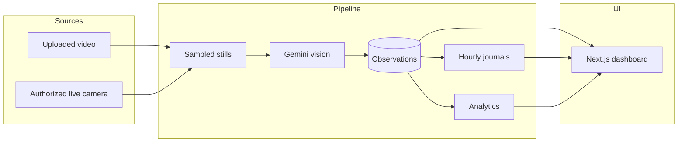
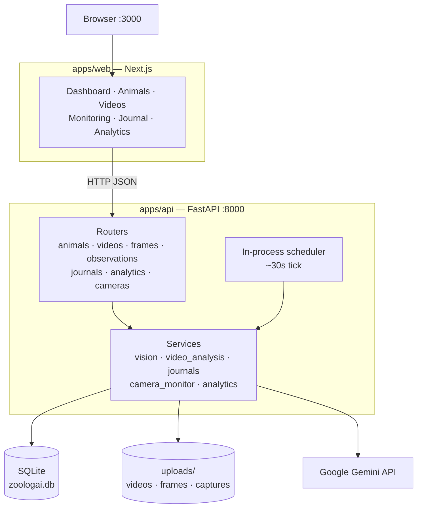
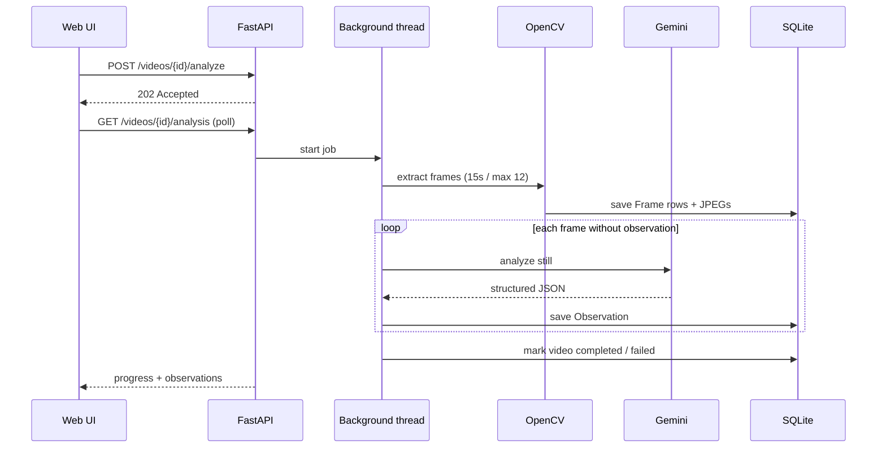
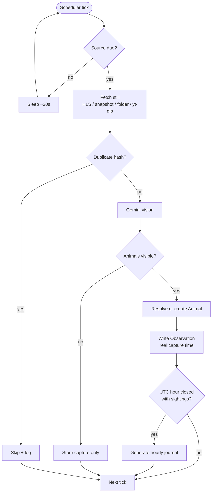
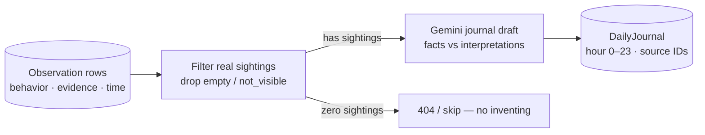

# ZooLog AI

ZooLog AI is a local-first observation platform for wildlife and zoo footage. It analyzes still frames with Gemini vision, stores verified sightings in SQLite, and writes **hourly journals** only when real observations exist for that hour.

| | |
|---|---|
| **Frontend** | Next.js (App Router, TypeScript, Tailwind) |
| **Backend** | FastAPI, SQLAlchemy, Alembic |
| **Database** | SQLite (`apps/api/zoologai.db`) |
| **Vision / text** | Google Gemini (`GEMINI_API_KEY`) |

---

## How it works



1. **Ingest** — upload a video, or poll an authorized camera / stream URL.
2. **Sample** — OpenCV extracts sparse stills (not every video frame).
3. **Observe** — Gemini labels behavior + visible evidence; results are validated and saved.
4. **Remember** — SQLite is the agent’s memory: observations are facts; journals are summaries of those facts.
5. **Review** — the web app shows animals, observations, journals, analytics, and monitor status.

**Design rule:** empty frames and `not_visible` sightings do not invent journal content. Missing samples mean missing data — not proven inactivity.

---

## System architecture



| Layer | Responsibility |
|-------|----------------|
| **Web** | UI, polling for long jobs, no secrets |
| **API** | AuthZ for cameras (`access_authorized`), validation, persistence |
| **Services** | OpenCV sampling, Gemini calls, journal drafting, monitor loop |
| **SQLite** | Animals, videos, frames, observations, journals, cameras, logs |
| **Disk** | Binary media (gitignored); metadata stays in the DB |

---

## Pipelines

### Video analysis



- Job is **non-blocking** (local thread; not Celery/Redis yet).
- Duplicate start while `pending` / `processing` → **409**.
- Cap: `MAX_AI_CALLS_PER_VIDEO_JOB` (default 12).

### Camera monitoring



Supported sources (authorized only):

- Direct **HLS / RTSP / MJPEG** or snapshot image URLs
- **YouTube / Explore.org** live pages when `access_authorized=true` (resolved with yt-dlp)
- **Local sample folder** for offline testing

Not supported: scraping protected zoo pages or bypassing stream access controls.

### Journals & memory



Default journal bucket = **one UTC hour**. Supporting observation IDs are stored for traceability.

---

## Repository layout

```
zoologai/
├── apps/
│   ├── web/                      # Next.js UI
│   │   └── src/app/              # dashboard, animals, videos, monitoring,
│   │                             # observations, journal, analytics
│   └── api/                      # FastAPI backend
│       ├── app/
│       │   ├── models/           # ORM
│       │   ├── schemas/          # Pydantic I/O
│       │   ├── routers/          # HTTP API
│       │   ├── services/         # Vision, jobs, monitor, analytics
│       │   ├── config.py
│       │   └── database.py
│       ├── alembic/              # Schema migrations
│       ├── scripts/              # seed, iNaturalist import, frame extract CLI
│       └── uploads/              # Private media (gitignored contents)
├── .env.example
└── README.md
```

---

## Quick start

### Prerequisites

- Node.js 20+ / npm  
- Python 3.11+  
- Gemini API key (Google AI Studio)

### Backend

```powershell
cd apps\api
python -m venv .venv
.\.venv\Scripts\Activate.ps1
pip install -r requirements.txt
Copy-Item .env.example .env
# Set GEMINI_API_KEY in apps/api/.env

alembic upgrade head
python -m scripts.seed
```

Optional public zoo-area import (iNaturalist attribution):

```powershell
python -m scripts.seed_zoo_inat
```

### Frontend

```powershell
cd apps\web
# apps/web/.env.local → NEXT_PUBLIC_API_URL=http://localhost:8000
npm install
```

### Run

| Terminal | Command | URL |
|----------|---------|-----|
| API | `uvicorn app.main:app --reload --host 127.0.0.1 --port 8000` | http://127.0.0.1:8000/docs |
| Web | `npm run dev` | http://localhost:3000 |

If port 8000 is busy, use `8001` and point `NEXT_PUBLIC_API_URL` at it.

---

## Product surfaces

| Route | Purpose |
|-------|---------|
| `/` | Live dashboard — animals, stats, recent observations & journals |
| `/animals` | Animal profiles |
| `/videos` | Upload, extract frames, analyze video |
| `/monitoring` | Authorized cameras, probe, extract stills, start/stop |
| `/observations` | Saved behavior labels |
| `/journal` | Hourly journals (All filter or per animal) |
| `/analytics` | Sample counts, coverage, day compare, weekly summary |

---

## API overview

| Area | Endpoints |
|------|-----------|
| **Animals** | `GET/POST /animals`, `GET/PATCH/DELETE /animals/{id}` |
| **Videos** | `POST /videos/upload`, `GET /videos`, `POST /videos/{id}/extract-frames`, `POST /videos/{id}/analyze`, `GET /videos/{id}/analysis` |
| **Frames** | `GET /videos/{id}/frames`, `POST /frames/{id}/analyze`, `GET /frames/{id}/observation` |
| **Observations** | `GET /observations`, `GET /observations/stats` |
| **Journals** | `GET /journals`, `GET /journals/eligibility`, `POST /journals/generate` |
| **Analytics** | `GET /analytics/behaviors`, `GET /analytics/compare-days`, `POST /analytics/weekly-summary` |
| **Cameras** | `GET/POST /cameras`, `start` / `stop` / `status`, `POST /cameras/probe`, `POST /cameras/extract-frames` |

Interactive docs: **http://127.0.0.1:8000/docs**

---

## Configuration

Copy from `.env.example` / `apps/api/.env.example`. **Never commit real keys.**

| Variable | Where | Notes |
|----------|--------|------|
| `NEXT_PUBLIC_API_URL` | `apps/web/.env.local` | Browser → API base URL |
| `DATABASE_URL` | `apps/api/.env` | Default SQLite file |
| `GEMINI_API_KEY` | `apps/api/.env` | Backend only |
| `GEMINI_MODEL` | `apps/api/.env` | e.g. `gemini-3.5-flash-lite` |
| `MAX_AI_CALLS_PER_VIDEO_JOB` | `apps/api/.env` | Cap per analyze job |
| `DEFAULT_MONITOR_INTERVAL_MINUTES` | `apps/api/.env` | Camera poll interval |

Uploads (`videos/`, `frames/`, `camera_captures/`, `extracted_frames/`) and `*.db` are gitignored.

---

## Integrity principles

- **No fabricated AI success** — missing keys and API errors surface as 5xx; we do not invent observations or journals.
- **Traceable journals** — generated text is grounded in stored observation IDs for that UTC hour.
- **Sample ≠ day share** — analytics count discrete samples; zeros mean no data collected.
- **Authorized capture only** — camera and extract endpoints require explicit permission flags for non-local sources.

---

## Deployment (Vercel UI + Oracle API)

Recommended split:

| Piece | Host | Why |
|-------|------|-----|
| Next.js UI | **Vercel** | Free hobby tier; appears on GitHub **Deployments** |
| FastAPI + SQLite + uploads + camera scheduler | **Oracle Cloud VM** | Always-on process + persistent disk |

1. Deploy the API on Oracle with HTTPS (`api.yourdomain.com`).
2. Set `CORS_ORIGINS` to your Vercel URL (preview URLs match `CORS_ORIGIN_REGEX`).
3. Import the repo in Vercel with **Root Directory** `apps/web`.
4. Set `NEXT_PUBLIC_API_URL=https://api.yourdomain.com` in Vercel.

Full steps: **[docs/deploy-vercel-oracle.md](docs/deploy-vercel-oracle.md)**

---

## License / attribution

Local project. Optional seed data from iNaturalist must retain source attribution when used.
